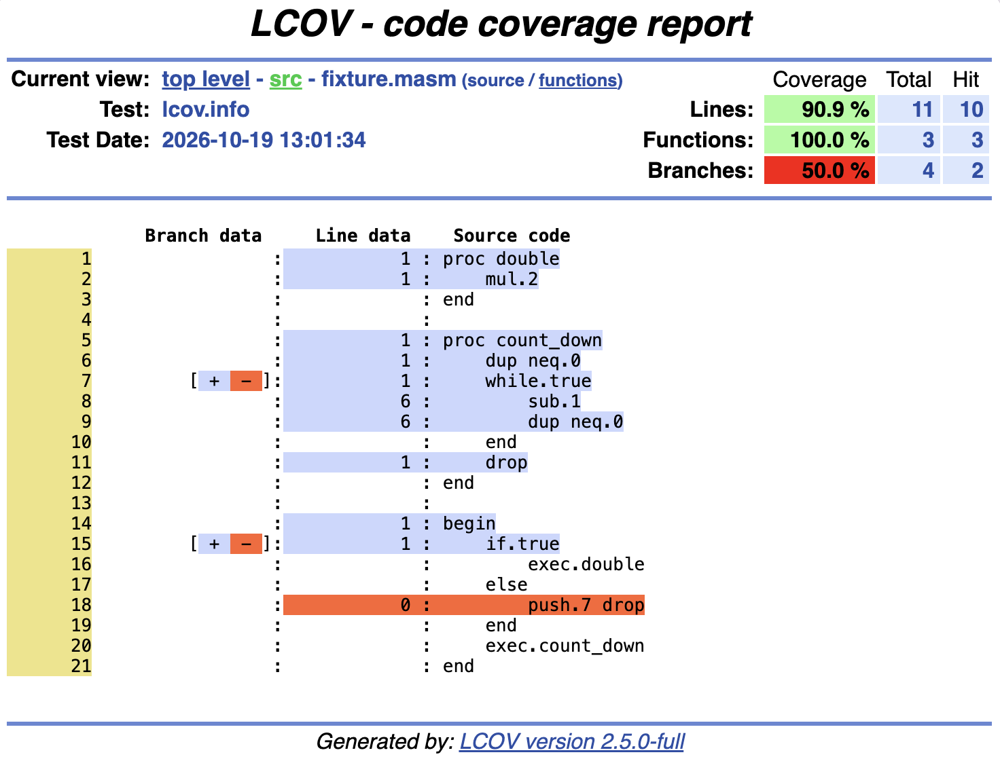

# miden-cov

Code coverage for Miden VM programs: Miden Assembly (MASM) and Rust compiled with the
Miden compiler.

Coverage is collected by observing VM execution and is mapped back to source files through
the debug info carried in Miden packages. Reports are produced in the LCOV format, so they
work with the usual coverage tooling (`genhtml`, IDE gutters, CI coverage services).

## Status

Early development. The MVP measures a standalone MASM program: run it, merge the runs, and
render LCOV with line, function, and branch coverage. See the roadmap below for what comes
next.

## Example report

The LCOV output of a small MASM program, rendered by `genhtml`. The run took the `if.true`
arm, so the `else` body shows zero hits and the branch markers show one arm untaken.



## Usage

Coverage needs a package (`.masp`) that kept its debug-info section. The assembler and the
Miden compiler keep it under the `dev` profile and strip it under `release` unless the
project sets `debug = true` for that profile in `miden-project.toml`. There is no separate
coverage build.

```sh
# Execute the package once per input set. Flags mirror `miden-debug`.
miden-cov run program.masp --inputs inputs-a.toml --name a
miden-cov run program.masp --inputs inputs-b.toml --name b

# Merge all runs, print a summary table, and write an LCOV trace and a
# single-page HTML report. Only files under the source root are reported;
# --include globs name files elsewhere, --exclude globs drop files.
miden-cov report --lcov lcov.info --html coverage.html

# Compare with the base branch's LCOV and a diff of the change: the page
# marks changed lines, and --markdown writes a pull request comment with the
# deltas and patch coverage, linking to the page at --page-url.
git diff next... > change.diff
miden-cov report --baseline base-lcov.info --diff change.diff \
  --html coverage.html --markdown comment.md --page-url "$PAGE_URL" --title 'Coverage'

# The LCOV trace also works with genhtml and editor gutters.
genhtml --branch-coverage --prefix "$PWD" --output-directory html lcov.info
```

Runs go to the coverage directory, `target/miden-cov` by default or `MIDEN_COV_DIR` when
set; `--cov-dir` overrides both. Each run is a separate file, so runs from different
processes or machines merge by being placed in the same directory. `report` resolves source
paths as stored in the debug info; use `--source-root <dir>` (the current directory by
default) or `--path-prefix-map OLD=NEW` when the sources live elsewhere. Files that cannot be
found are summarized one line per package with the directory they were expected under.
`miden-cov dump <run-file>` prints the raw hits of one run as JSON.

## Getting your contract's coverage

[`examples/wallet`](examples/wallet) is a small contract project tested the way the Miden
protocol tests its MASM: Rust tests prepare the kernel, the advice inputs and the event
handlers, then run programs through the collector's `CoverageExecutor`. Its tests need no
change to be measured; setting `MIDEN_COV_DIR` is enough. The crate documentation shows the
steps, and `make miden-coverage` runs them, writing the LCOV and the HTML page to
`target/miden-coverage`. CI does the same on every pull request and posts the comparison with
the base branch as a comment.

## Roadmap

Each phase is a GitHub issue with its scope and what "done" means.

- [x] [#1](https://github.com/0xMiden/cov/issues/1) Measure coverage of a pure MASM program
- [ ] [#2](https://github.com/0xMiden/cov/issues/2) Collect coverage from Rust test suites
      (protocol, VM and user contracts)
- [ ] [#3](https://github.com/0xMiden/cov/issues/3) Measure coverage of Rust programs compiled
      with `cargo miden`
- [ ] [#4](https://github.com/0xMiden/cov/issues/4) Add a JSON report for agents writing tests
- [ ] [#5](https://github.com/0xMiden/cov/issues/5) Post the coverage of Miden code on PRs

## Building and testing

The toolchain is pinned in `rust-toolchain.toml`. Tests run with
[cargo-nextest](https://nexte.st/).

```sh
make build        # build the workspace in release mode
make test         # run the test suite
make coverage     # coverage of this repository's Rust code, written to rust-coverage.xml
make miden-coverage  # coverage of the example's Miden code, written to target/miden-coverage
make lint         # clippy, rustfmt check, cargo-shear and the collector without std
make fix          # apply clippy and rustfmt fixes
make doc          # build and check the documentation
make help         # list all targets
```

Formatting uses a pinned nightly rustfmt; install it with `make install-rustfmt`.

## Documentation

- [Architecture](docs/architecture.md)
- [Design decisions](docs/decisions/)
- [Release process](docs/release-process.md)

## Contributing

See [CONTRIBUTING.md](CONTRIBUTING.md).

## License

This project is [MIT licensed](LICENSE.md).
